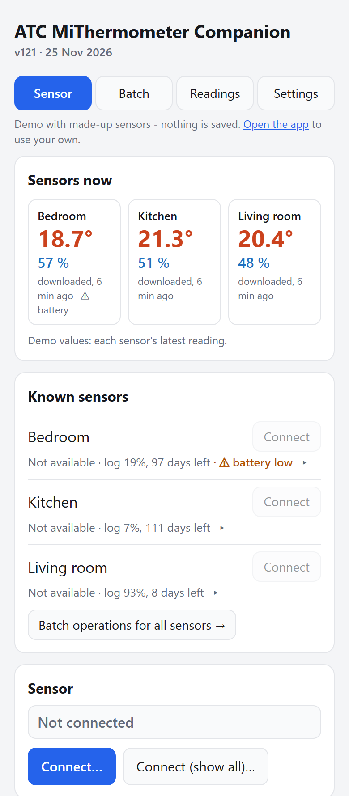
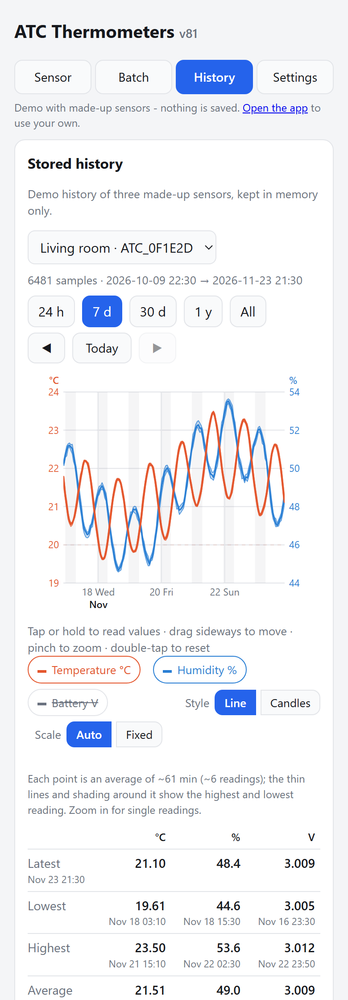
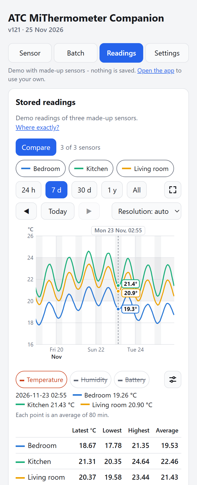

# ATC MiThermometer Companion

**Record and view the temperature and humidity history of your Xiaomi Mi Temperature and Humidity Monitor 2 (LYWSD03MMC) on an iPhone**, without Home Assistant, a gateway, the Mi Home app or a cloud account. A free web app for sensors running [pvvx's ATC firmware](https://github.com/pvvx/ATC_MiThermometer), plus a [command-line tool](python/) for Windows, macOS and Linux.

**Open the app:** https://adam-nemeth.github.io/atc-companion/ · **Try it without a sensor:** [demo](https://adam-nemeth.github.io/atc-companion/?demo)

<p>
  
  
  
</p>

## What you can do

- **Download the sensor's own log** over Bluetooth: with the pvvx firmware, each sensor stores weeks to months of readings by itself, so you only need to come by now and then.
- **Charts** of temperature, humidity and battery: zoom, scroll, tap for values, candles, min/max/average, night shading, full screen when you turn the phone.
- **Compare rooms**: up to 8 sensors in one chart.
- **Export CSV** for Excel, Numbers or Google Sheets: one or more sensors, a period of your choice, also as one ZIP file. CSV and ZIP files can be imported again.
- **Many sensors at once**: download, set clocks and change settings for all of them in one go.
- **Warnings** before a sensor's log is full or its battery runs low.
- **Correct clock drift**: the sensors' clocks run fast or slow, and the readings are moved back to the right time.
- **Backup and restore**: one file with all readings, sensors and settings, e.g. for a new phone.
- **Sensor settings**: measurement and logging intervals, display, calibration, Bluetooth name.

Your data stays on your phone. Nothing is sent anywhere.

## How to use

1. Flash the pvvx firmware onto the sensor (see the [pvvx project](https://github.com/pvvx/ATC_MiThermometer)).
2. On the iPhone, install the free **Bluefy** browser (Safari has no Web Bluetooth) and open the link above.
3. **Sensor** tab: *Connect…* → pick the sensor → *Download, set clock & erase…* (*Set clock & erase* is one option, on by default; the button says what it will do, and the app asks before erasing).
4. **Readings** tab: chart (pinch to zoom, drag to move, tap for values, turn the phone sideways for full screen), min/max/average, *Compare* for several sensors in one chart, and *Export CSV* for one or more sensors (also as one ZIP file).
5. **Batch** tab: the same for all your sensors in one go, with a retry for those that failed.

The app reminds you to save a backup (to Files, iCloud Drive, mail…) now and then.

## Questions

**Can I see the history of a Xiaomi thermometer on an iPhone?**
Yes, if the sensor runs the pvvx firmware: open the app in the Bluefy browser, connect and download. Safari can't, because it has no Web Bluetooth.

**Do I need Home Assistant, a hub or a Raspberry Pi?**
No. The phone talks to the sensor directly, over Bluetooth. You only need to be near the sensor when downloading.

**Which sensors and firmware does it work with?**
It's made for the Xiaomi Mi Temperature and Humidity Monitor 2 (LYWSD03MMC) with [pvvx's ATC_MiThermometer firmware](https://github.com/pvvx/ATC_MiThermometer). It can't read sensors with the original Xiaomi firmware or atc1441's older firmware.

**How do I get the readings into Excel?**
Readings tab → *Export CSV…*. Choose the "hu" format (semicolons, decimal commas) if your Excel uses decimal commas, as in most European languages, and "en" if it uses decimal points. Times are in UTC.

**Does it work on Android or a computer?**
Chrome and Edge have Web Bluetooth too, so the app should work there, but it's made and tested for the iPhone. On a computer, the [command-line tool](python/) is the tested way.

**How long does the sensor keep its readings?**
It depends on the logging interval: at one reading every 10 minutes, about 4 months. The app shows how full each sensor's log is and warns a week before it starts overwriting the oldest readings.

## Tribute

This only works thanks to [**pvvx/ATC_MiThermometer**](https://github.com/pvvx/ATC_MiThermometer), the custom firmware by pvvx (building on atc1441's original). It gives these sensors on-device logging, a configurable clock and an open Bluetooth protocol. Everything here talks to that firmware. Thank you!

## On a computer

[`python/ATC_MiThermometer_tools.py`](python/) is a command-line tool for Windows, macOS and Linux. It does the same jobs (download, clocks, settings) for many sensors at once and keeps a growing CSV archive per sensor, in the same format as the app. See [its README](python/README.md).

## For developers

The app is a single page, [`index.html`](index.html), with its logic in [`core.js`](core.js). Tests need no installs, and run on GitHub with every push:

```
node --test tests/
python -m unittest discover -s tests
```

Both test the clock-drift correction against the same simulated sensor logs ([`tests/fixtures`](tests/fixtures/), made by [`tests/make_fixtures.py`](tests/make_fixtures.py)), so the app and the Python tool stay in step.

## License

[MIT](LICENSE)
